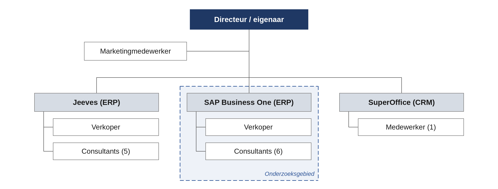

# Onderzoeksvoorstel afstuderen TBK – JIS Nederland

> **Concept.** Dit bestand is de bron van de tekst in `onderzoeksvoorstel.docx` (het ingevulde originele formulier).
> Pas de tekst hier aan en genereer de `.docx` opnieuw met `python3 tools/vul_formulier.py`. Vul alle
> `[INVULLEN: …]`-velden in vóór het indienen. Structuur en kopjes volgen het *Formulier Onderzoeksvoorstel
> Technische Bedrijfskunde deeltijd*.

**Datum:** 22-11-2026

## 1. Gegevens student

| Veld | Invulling |
|---|---|
| Naam student & studentnummer | Koen Scholten, 311496 |
| Telefoonnummer | 0619520068 |
| Opleiding | SPS TBK Enschede |
| Afstudeerperiode | van: 01-01-2027 t/m: 31-05-2027 |
| Propedeuse behaald | ja |
| Max. 20 studiepunten openstaan | ja |
| Openstaande vakken | geen |

## 2. Gegevens bedrijf en bedrijfsbegeleider

| Veld | Invulling |
|---|---|
| Naam bedrijf | JIS Nederland |
| Naam opdrachtgever | T. Diepenmaat, directeur/eigenaar JIS Nederland |
| Bedrijfssoort/sector | ICT-dienstverlening: verkoop en implementatie van ERP-systemen (Jeeves ERP, SAP Business One) en CRM (SuperOffice) |
| Aantal medewerkers | 16 |
| (Bezoek)adres | Demmersweg 9-13 |
| Postcode | 7556BN |
| Plaats | Hengelo (OV) |
| Land | Nederland |
| Alg. telefoonnummer | 074-2552580 |
| Homepage | www.jisnl.com |
| Alg. e-mail | info@jisnl.com |
| Postbusnr | n.v.t. |
| Postcode postbus | n.v.t. |
| Persoonlijke relatie | Ja, nl: ik werk sinds oktober 2024 als consultant SAP Business One in het onderzochte team (zie 3d voor de maatregelen voor objectiviteit). |
| Naam bedrijfsbegeleider | Tonnie Diepenmaat (M) |
| Voorletters | T. |
| Roepnaam | Tonnie |
| Afdeling | Directie |
| Functie en opleidingsniveau | Directeur / WO |
| Tijd voor begeleiding (min. 2 uur per week) | ja |
| Telefoonnr. begeleider | 074-2552580 |
| Mobiel begeleider | 06-52344464 |
| E-mailadres begeleider | Tonnie.diepenmaat@jisnl.com |

### Organisatie

**Onderzoeksgebied.** JIS Nederland verkoopt en implementeert ERP-systemen. Daarvoor zijn er twee teams: één voor
Jeeves ERP en één voor SAP Business One. Sinds kort verkoopt JIS ook het CRM-systeem SuperOffice, als aparte
productlijn. Mijn onderzoek gaat over het SAP Business One-team, waarin zes consultants werken, en over de manier
waarop dit team projecten uitvoert. Dat proces begint bij de overdracht vanuit sales en loopt via vooranalyse,
inrichting, datamigratie en testen naar de go-live en de overdracht naar nazorg. Directie, sales en support betrek ik
als stakeholders. Het Jeeves-team, SuperOffice en het verkoopproces zelf onderzoek ik niet. In bijlage 1 staat een
organogram waarin het onderzoeksgebied is aangegeven.

**Technische omgeving.** In een ERP-systeem richt een bedrijf zijn primaire processen in, zoals inkoop, voorraad,
productie, verkoop en financiën. De klanten van JIS zijn vooral productie- en handelsbedrijven. Wat ik onderzoek is
het implementatieproces zelf. In dat proces komen systeemconfiguratie, datamigratie, koppelingen en testen samen met
het inrichten van de logistieke en productieprocessen van de klant. Het is dus een technisch-bedrijfskundig
projectproces, en de opdracht speelt zich af in een technische omgeving.

## 3. De opdracht / het uit te voeren onderzoek

### 3a. Probleemstelling

Het SAP Business One-team doet alle klantprojecten voor dit pakket. Dat zijn volledige implementaties, maar ook
add-ons en kleinere uitbreidingen. Hieronder beschrijf ik het probleem aan de hand van de 6W-methode (Leen & Mertens,
2017).

**Wat is het probleem?** Het team heeft geen standaard projectproces. Elke consultant werkt op zijn of haar eigen
manier. Er zijn geen vaste fasen, deliverables of overdrachtsmomenten, en inrichtingskeuzes en klantafspraken worden
niet op een vaste manier vastgelegd. Veel projectkennis zit daardoor alleen in het hoofd van de consultant.

**Wat is de aanleiding?** Het team is in korte tijd gegroeid van één naar zes consultants. In dezelfde periode zien we
dat uren worden overschreden, go-lives worden uitgesteld en er na de go-live nog veel herstelwerk (rework) nodig is.
Hoe groot dat precies is, is nog niet gemeten. Dat doe ik in de Measure-fase.

**Wie heeft het probleem?** De directie is probleemeigenaar, omdat zij verantwoordelijk is voor rendement en groei.
Maar ook anderen merken het. Consultants hebben last van rework en lastige overdrachten. Sales krijgt te maken met
begrotingen die niet kloppen, en support met meldingen na de go-live. Klanten merken het indirect, doordat projecten
uitlopen of er fouten in zitten.

**Wanneer is het ontstaan?** Met de groei van het team. Met één consultant kon alles informeel. Met zes consultants
en meer projecten tegelijk werkt dat niet meer.

**Waarom is het een probleem?** Uren die boven het budget uitkomen zijn vaak niet te factureren. Projecten worden
minder voorspelbaar en klanten minder tevreden. Daarnaast is het team kwetsbaar als een consultant uitvalt of een
project moet overdragen. Zo staat het probleem verdere groei van het team in de weg.

**Waar doet het probleem zich voor?** In het projectproces van het SAP Business One-team, van de overdracht door sales
tot de overdracht naar nazorg.

Het gaat dus om een procesvraagstuk in een technische omgeving. De kern is het (her)ontwerpen van een projectproces.

### 3b. Opdrachtomschrijving

**Werktitel.** *Van ieder z'n eigen aanpak naar een standaard projectproces: ontwerp van een schaalbare,
AI-ondersteunde implementatiemethode voor het SAP Business One-team van JIS Nederland.*

Mijn opdracht is een standaard projectmethode te ontwerpen voor het SAP Business One-team, die ook werkt als het team
verder groeit. De methode moet bestaan uit:

- één kernproces met vaste fasen, deliverables, templates of checklists en overdrachtsmomenten;
- een lichtere variant voor add-ons en kleine uitbreidingen. Een projectclassificatie bepaalt per type project welke
  deliverables verplicht zijn;
- drie tot vijf KPI's om op te sturen, zoals bestede uren tegenover het budget, de werkelijke go-live tegenover de
  planning en de hoeveelheid rework na go-live;
- minstens één toepassing van AI die helpt bij het vastleggen, borgen en overdragen van projectkennis.

Ik lever een gevalideerd ontwerp op, met een kosten-batenanalyse en een implementatieplan. Daarmee is de invoering
voorbereid, maar de invoering zelf valt buiten mijn afstudeerperiode. Verder vallen buiten de scope: het Jeeves-team,
het CRM-pakket (SuperOffice), het verkoopproces (behalve de overdracht naar de consultant), support als proces (dat
gebruik ik alleen als databron) en het bouwen of beheren van een eigen AI-tool.

De opdracht is **multidisciplinair**, omdat er meerdere vakgebieden in samenkomen. Procesmanagement gaat over het
ontwerpen en standaardiseren van het proces en het opstellen van KPI's. Projectmanagement gaat over fasering, begroting
en bestaande methoden voor ERP-implementaties. Kennismanagement is nodig om klantkennis te borgen en over te dragen.
Technologie en innovatie komt terug in de inzet van ERP en AI bij het werk van consultants. Tot slot speelt het
vakgebied mensen in organisaties een rol: standaardiseren raakt aan de vrijheid die consultants nu hebben, dus
draagvlak en weerstand zijn belangrijk.

De opdracht is **innovatief**. JIS heeft nog geen projectmethode, de methode past zich aan het type project aan en
generatieve AI wordt ingezet bij het werk van consultants. Daarbij gelden de AVG en de vertrouwelijkheid van
klantdata als harde voorwaarde.

De opdracht is **tactisch/operationeel** van aard. Het gaat om hoe projecten worden uitgevoerd, overgedragen en
gestuurd, dus om de inrichting en besturing van het primaire proces. Er is wel een strategische kant: de methode moet
het team in staat stellen te groeien zonder dat de kwaliteit daalt.

De **technische omgeving** is het implementeren van ERP-systemen, waarbij de logistieke, productie- en financiële
processen van klanten worden ingericht (zie onderdeel 2, Organisatie).

### 3c. Doelstelling, onderzoeksvraag en deelvragen

**Doel van het bedrijf (extern doel).** JIS wil dat SAP Business One-projecten voorspelbaarder en beter verlopen, met
minder urenoverschrijding, minder uitgestelde go-lives en minder rework na go-live. Zo kan het team groeien zonder dat
de kwaliteit eronder lijdt.

**Onderzoeksdoel (intern doel).** In opdracht van de directie van JIS Nederland voer ik een ontwerpgericht onderzoek
uit. Het doel is om binnen de afstudeerperiode van 18 weken (uiterlijk 31-05-2027) een gestandaardiseerde, schaalbare
en door AI ondersteunde projectmethode te ontwerpen en te valideren voor implementaties en add-ons van het SAP
Business One-team. De methode bestaat uit een kernproces met een lichte variant voor add-ons, vaste deliverables voor
vastlegging en overdracht, drie tot vijf KPI's met streefwaarden en minstens één uitgewerkte AI-toepassing. Ik lever
het ontwerp op in een adviesrapport met kosten-batenanalyse en implementatieplan, zodat JIS de uren- en
planningsoverschrijdingen en het rework na go-live structureel kan terugdringen. De streefwaarden van de KPI's bepaal ik
op basis van de nulmeting in de Measure-fase.

**Hoofdvraag.** Hoe moet een gestandaardiseerde, schaalbare en door AI ondersteunde projectmethode voor implementaties
en add-ons van het SAP Business One-team van JIS Nederland eruitzien, zodat de uren- en planningsoverschrijdingen en
het rework na go-live afnemen, en hoe kan deze vóór 31-05-2027 als gevalideerd ontwerp met implementatieplan
worden opgeleverd?

**Deelvragen.** Elke deelvraag hoort bij een fase van DMADV en bouwt voort op de vorige.

**1. (Define)** Hoe verloopt het projectproces nu per type project (volledige implementatie, add-on, kleine uitbreiding), van de overdracht door sales tot de overdracht naar nazorg, en welke stakeholders en belangen spelen daarbij een rol?

**2. (Measure)** Aan welke eisen moet een standaardmethode volgens de stakeholders voldoen (CTQ's), en hoe scoort het huidige proces op uren ten opzichte van het budget, go-live ten opzichte van de planning en rework na go-live?

**3. (Analyze)** Welke oorzaken in het proces verklaren de afwijkingen, en welke ontwerpalternatieven passen bij de eisen, bijvoorbeeld een lichte vorm van SAP Activate, een faseringsmodel of werken met checklists?

**4. (Design)** Hoe ziet de methode eruit: het kernproces, de lichte variant, de deliverables, de templates, de KPI's met streefwaarden en de taakverdeling tussen sales en consultant?

**4b. (Design)** Welke AI-toepassingen helpen bij het vastleggen, borgen en overdragen van kennis binnen de methode, binnen de grenzen van de AVG en het beleid van JIS?

**5. (Verify)** In hoeverre voldoet het ontwerp aan de eisen (CTQ's), staan de stakeholders erachter, en wat zijn de kosten, de baten en de stappen voor invoering?

Voor dit vraagstuk is bedrijfskundig onderzoek nodig. Het probleem is nog niet in kaart gebracht en er ligt geen
kant-en-klare oplossing klaar. Bestaande methoden zoals SAP Activate zijn bedoeld voor grotere projecten en teams. Om
tot een passende methode te komen moet ik data en interviews systematisch analyseren, alternatieven tegen elkaar
afwegen en literatuur uit verschillende vakgebieden gebruiken.

### 3d. Onderzoeksontwerp

**Type onderzoek en procesmodel.** Ik doe een ontwerpgericht praktijkonderzoek (Leen & Mertens, 2017) en volg
daarbij de DMADV-cyclus uit Design for Six Sigma (Yang & El-Haik, 2009). Ik kies voor DMADV en niet voor DMAIC, omdat
er nog geen standaardproces is dat verbeterd kan worden. Er moet een nieuw proces komen. In de Measure-fase leg ik de
eisen (CTQ's) en de nulmeting vast. In Analyze zoek ik de oorzaken en de mogelijke ontwerpen, en in Verify toets ik
het ontwerp.

| Deelvraag (fase) | Dataverzameling | Analyse | Resultaat |
|---|---|---|---|
| 1 (Define) | Semigestructureerde interviews met consultants, directie, sales en support; projectdossiers | Procesmapping per projecttype (swimlane, brown paper); macht-belangmatrix | Huidig procesmodel, stakeholderanalyse en afbakening |
| 2 (Measure) | Interviews (eisen); bestaande data: urenregistratie, budgetten en planning, supporttickets na go-live | CTQ-boom; beschrijvende statistiek per projecttype | Eisenlijst (CTQ's) en nulmeting van de KPI's |
| 3 (Analyze) | Data en interviews uit 1–2; dossiers en mail; literatuur over ERP-implementatiemethoden | Visgraatdiagram, Pareto, triangulatie; afwegingsmatrix van alternatieven tegen de CTQ's | Oorzakenanalyse en gekozen ontwerprichting |
| 4 (Design) | Literatuur; co-design-sessie(s) met consultants | Procesontwerp in BPMN (Dumas et al., 2018); SECI-model voor kennisborging (Nonaka & Takeuchi, 1995) | Procesontwerp, templates/checklists, KPI-set met streefwaarden |
| 4b (Design) | Literatuur over AI in kenniswerk; inventarisatie van tools en het beleid van JIS | Afwegingsmatrix (nut, risico, kosten); TAM (Davis, 1989); toets aan de AVG | Uitgewerkte AI-toepassing(en) met randvoorwaarden |
| 5 (Verify) | Validatiesessie met consultants en directie; droogtest op een afgerond project; AI-test met een geanonimiseerd voorbeeld | Toets aan de CTQ's (member check); kosten-batenanalyse; verandermodel (Kotter, 1996) | Gevalideerd ontwerp, kosten-batenanalyse en implementatieplan |

**Betrouwbaarheid en validiteit.** Ik onderzoek mijn eigen team. Daarom verwerk ik interviews anoniem en kijk ik naar
het proces, niet naar personen. Bevindingen controleer ik vanuit meerdere bronnen: data, interviews en dossiers. Ik leg
ze ook voor aan de mensen die ik heb geïnterviewd (member check) en bespreek ze met mijn bedrijfsbegeleider. Met een
interviewprotocol en een onderzoekslogboek is het onderzoek te herhalen. Het onderzoek heeft ook beperkingen. Klanten
interview ik niet; hun kant van het verhaal haal ik uit supporttickets, dossiers en gesprekken met sales. Verder is het
aantal volledige implementaties klein. Door ook add-ons en kleine uitbreidingen mee te nemen heb ik meer cases, maar de
analyse blijft vooral kwalitatief. Klantgegevens gaan nooit zonder toestemming naar externe AI-tools.

**Haalbaarheid in 18 weken.** Ik doe het onderzoek alleen, en grotendeels in mijn eigen tijd. Daarvoor plan ik vaste
momenten in het weekend. Interviews, sessies met collega's en het ophalen van bedrijfsdata doe ik in werktijd. Ik werk
met bestaande data en interne bronnen en lever één kernproduct op. De invoering hoort er niet bij, Verify is een
validatie en geen pilot, en AI is beperkt tot één deelvraag (4b). Mijn globale planning:

- week 1–3: onderzoeksplan;
- week 3–5: Define;
- week 5–7: Measure;
- week 7–9: Analyze;
- week 9–12: Design;
- week 12–14: Verify, kosten-batenanalyse en implementatieplan;
- week 15: overzicht beroepsproducten;
- week 15–18: adviesrapport, portfolio en reflectieverslag.

#### Bronnen

Davis, F. D. (1989). Perceived usefulness, perceived ease of use, and user acceptance of information technology. *MIS Quarterly, 13*(3), 319–340. https://doi.org/10.2307/249008

Dumas, M., La Rosa, M., Mendling, J., & Reijers, H. A. (2018). *Fundamentals of business process management* (2nd ed.). Springer.

Kotter, J. P. (1996). *Leading change*. Harvard Business School Press.

Leen, J., & Mertens, J. (2017). *Praktijkgericht onderzoek in bedrijf* (2e druk). Coutinho.

Nonaka, I., & Takeuchi, H. (1995). *The knowledge-creating company: How Japanese companies create the dynamics of innovation*. Oxford University Press.

Yang, K., & El-Haik, B. (2009). *Design for Six Sigma: A roadmap for product development* (2nd ed.). McGraw-Hill.

#### Verantwoording AI-gebruik

Bij het structureren en formuleren van dit voorstel heb ik Claude gebruikt (Anthropic, 2026). De inhoud is van mij:
ik heb alles gecontroleerd, aangevuld en herschreven, en ik ben verantwoordelijk voor de tekst. Hoe ik AI gebruik,
houd ik bij in een logboek.

Anthropic. (2026). *Claude* [Groot taalmodel]. https://claude.ai

## Bijlage 1 – Organogram JIS Nederland

